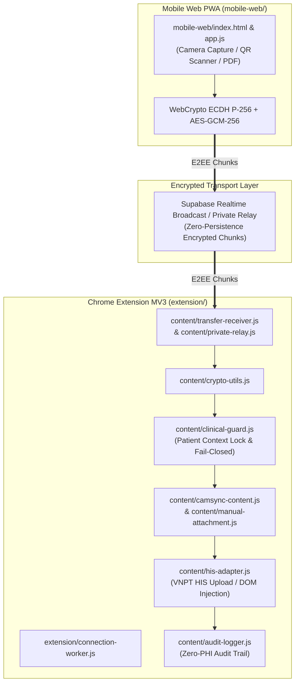

# HIS CamSync — Architecture Map

## Overview

`his-camsync` là hệ thống đồng bộ hình ảnh lâm sàng (ECG, vết thương, giấy tờ hành chính, tài liệu PDF) từ điện thoại di động (Mobile Web PWA) trực tiếp vào hồ sơ bệnh án trên máy trạm VNPT HIS thông qua mã hóa đầu cuối (End-to-End Encryption - ECDH P-256 + AES-GCM-256) và cơ chế khóa ngữ cảnh bệnh nhân nghiêm ngặt (`clinical-guard.js`).

## Architecture Diagram

## Blast Radius Matrix

| Component / Module | Files | Blast Radius | Risk Level | Description |
| :--- | :--- | :--- | :--- | :--- |
| **Clinical Context Guard** | `extension/content/clinical-guard.js` | **Global** | **CRITICAL** | Kiểm tra khớp ngữ cảnh bệnh nhân giữa lúc tạo phiên QR và lúc nhận/đính kèm file. Nếu bệnh nhân trên màn hình HIS thay đổi, bắt buộc khóa thao tác (Fail-Closed). |
| **E2EE Cryptography** | `extension/content/crypto-utils.js`, `mobile-web/*` | **Global** | **CRITICAL** | Thực hiện trao đổi khóa ECDH P-256 và giải mã AES-GCM-256. Thay đổi sai lệch sẽ làm hỏng toàn bộ kết nối giữa điện thoại và máy trạm. |
| **Transfer Receiver & Relay** | `extension/content/transfer-receiver.js`, `extension/content/private-relay.js`, `extension/connection-worker.js` | **High** | **HIGH** | Quản lý ghép mảnh dữ liệu (chunk reassembly), kiểm tra định dạng nhị phân (JPEG JFIF / PNG / PDF) và tự động kết nối lại. |
| **VNPT HIS Adapter** | `extension/content/his-adapter.js`, `extension/content/manual-attachment.js` | **High** | **HIGH** | Đẩy file đã xác nhận vào form upload của VNPT HIS (`/vnpthis/upload`). Phụ thuộc vào cấu trúc DOM và API của HIS. |
| **Extension UI & QR Panel** | `extension/content/camsync-content.js`, `extension/styles/*` | **Medium** | **MEDIUM** | Hiển thị mã QR ghép nối, trạng thái nhận ảnh và hộp thoại xác nhận đính kèm theo chuẩn Quiet Clinical Utility (`DESIGN.md`). |
| **Mobile Web PWA UI/UX** | `mobile-web/index.html`, `mobile-web/css/style.css`, `mobile-web/js/editor.js`, `mobile-web/js/pdf-builder.js` | **Low** | **MEDIUM** | Giao diện chụp ảnh ECG, Siêu âm, Scan tài liệu nhiều trang trên điện thoại theo chuẩn Quiet Clinical Utility + Lucian Clinical Motion (`--clinical`, 0% `backdrop-filter: blur`), hoàn toàn tách biệt với kênh mã hóa E2EE và chốt chặn HIS. |
| **Zero-PHI Audit Logger** | `extension/content/audit-logger.js` | **Low** | **MEDIUM** | Ghi nhật ký thao tác phục vụ kiểm toán an toàn thông tin, tuyệt đối không lưu tên hay mã bệnh nhân dạng rõ (raw PHI). |

## Known Issues & Key Decisions (Hồ sơ Bệnh án Dự án)

1. **Chốt chặn xác nhận đính kèm Fail-Closed (`FILE_READY` vs `HIS_UNKNOWN`):**
   - **Nguyên nhân & Quyết định:** Trạng thái mạng di động tại buồng bệnh có thể chập chờn đúng lúc chờ máy trạm phản hồi. Giao diện điện thoại (bao gồm vòng tiến trình và dấu tích xanh `#uploadProgressCard.is-ok`) **chỉ** được phép báo thành công khi nhận đúng xác nhận `success === true && status === 'FILE_READY'` từ máy trạm; nếu `HIS_UNKNOWN` hoặc lỗi, bắt buộc giữ trạng thái cảnh báo để bác sĩ kiểm tra ô đính kèm trên HIS trước khi gửi lại, tránh nhân đôi file.
2. **Bố cục Mobile 1 màn hình (`375x667`+) & Nút xóa trang kèm Hoàn tác 4 giây (`mobile-web/`):**
   - **Vấn đề từng gặp:** Trên màn hình nhỏ (`375x667`), nhãn tab *Điện Tâm Đồ (ECG)* bị gãy 2 dòng, chế độ Tài liệu bị tràn chiều dọc đẩy nút *Gửi tới máy tính* khuất xuống dưới, và nút xóa trang (`18x18px`) nằm trong khung `overflow: hidden` nên bị xén góc, bấm nhầm là mất trang ngay.
   - **Cách xử lý dứt điểm:** Chuẩn hóa 3 tab 1 dòng bằng CSS Grid + viên thuốc trượt đàn hồi (`ResizeObserver` tự đồng bộ kích thước khi bộ đếm dung lượng thay đổi); tách lớp `.doc-thumb-media` (`overflow: hidden`) khỏi `.doc-thumb-item` (`overflow: visible`) với nút xóa `24x24px` (vùng chạm mở rộng) kèm thanh **Hoàn tác 4 giây** (chỉ thu hồi `URL.revokeObjectURL` sau khi hết 4 giây hoặc đóng trang để chống rò rỉ bộ nhớ); kiểm chứng tự động qua `tests/mobile-ux-lucian.test.js` và `tests/manual-browser-smoke.cjs`.
3. **Bảo toàn hiệu ứng lò xo khi chuyển tab (`exitEditOverlay` Guard):**
   - **Vấn đề từng gặp:** Gọi `exitCropMode()` vô điều kiện trong `switchSpecialty()` từng xếp hàng `requestAnimationFrame` ghi đè lại lớp hướng trượt (`go-r` / `go-l`) sau 16ms.
   - **Cách xử lý dứt điểm:** Chỉ thu dọn lớp phủ chỉnh sửa khi thực sự đang ở chế độ cắt/nắn góc (`wasEditing === true`).
